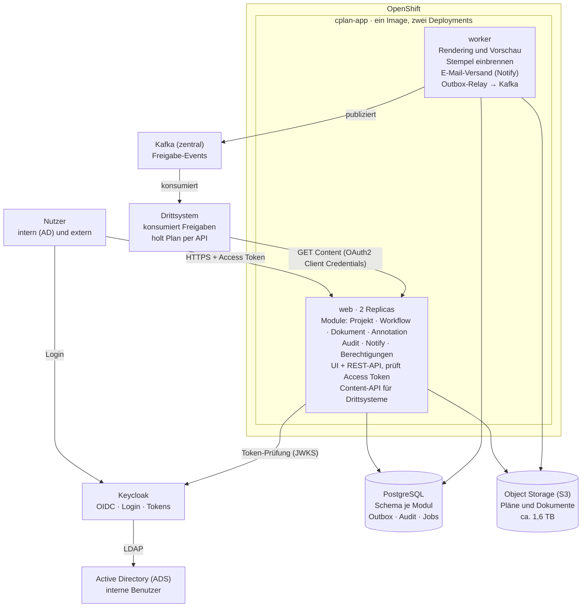

# C.Plan – Architekturübersicht

Stand: 14.11.2026

C.Plan wird als **modularer Monolith** auf OpenShift gebaut. Außerhalb der Anwendung liegen nur Keycloak für die Anmeldung, PostgreSQL und S3 für die Daten sowie der zentrale Kafka für die Schnittstelle zu Drittsystemen.

## Entscheidung

- **Ein Codebase, ein Image, zwei Deployments:** `web` (UI und REST-API, 2 Replicas) und `worker` (Rendering, Stempel, E-Mail, Outbox-Relay).
- **Fachliche Module mit harten Grenzen** statt verteilter Services. Ein Modul kann später herausgelöst werden, wenn es einen konkreten Grund gibt (eigenes Team, eigener Release-Zyklus, abweichende Last).
- **Keycloak** übernimmt die Anmeldung per OIDC: interne Nutzer über das AD, externe Projektbeteiligte als lokale Keycloak-User.
- **Kafka** wird nur als Außenschnittstelle genutzt, um Freigaben an Drittsysteme zu melden. Notify und Audit bleiben in der Anwendung bzw. in der Datenbank.

## Rahmenbedingungen

| Thema | Stand |
|---|---|
| Team | Projektleitung, technischer Hauptverantwortlicher, ein Software Engineer |
| Technologie | Java mit Spring Boot, PostgreSQL, S3 |
| Betriebsplattform | OpenShift |
| Nutzung | ca. 500 User, ca. 100 laufende Projekte |
| Dokumente | ca. 1,6 TB |
| Integration | Authentifizierung über das AD; Drittsystem holt freigegebene Pläne ab |
| Kafka | zentral vorhanden, wird bereitgestellt |
| Migration | projektweise aus C.DES |

Bei einem einzigen Entwickler würden Microservices vor allem Betriebs- und Konsistenzaufwand erzeugen (mehrere Pipelines, verteilte Transaktionen im Freigabeprozess, verteiltes Tracing). Die Last ist für einen horizontal skalierten Monolithen gering. Die eigentliche Herausforderung sind die 1,6 TB Dokumente, und das ist eine Frage der Speicherstrategie, nicht des Service-Schnitts.

## Architekturdiagramm



Nutzer melden sich über Keycloak an, `web` prüft das Access Token bei jedem Aufruf. Der `worker` arbeitet über dieselbe Datenbank und denselben Object Storage und publiziert Freigaben über die Outbox nach Kafka. Das Drittsystem holt die Datei danach über die Content-API ab.

## Bausteine

| Baustein | Aufgabe | Umsetzung |
|---|---|---|
| cplan-app `web` | UI, REST-API, alle Fachmodule, Content-API für Drittsysteme | 2 Replicas, zustandslos (Access Token statt Server-Session) |
| cplan-app `worker` | Rendering und Vorschau, Stempel einbrennen, E-Mail-Versand, Outbox-Relay nach Kafka | dasselbe Image, eigenes Deployment, per Profil gesteuert |
| PostgreSQL | Metadaten, ein Schema je Modul, Outbox, Audit, Job-Queue | Job-Queue als Tabelle (`SELECT … FOR UPDATE SKIP LOCKED`), kein eigener Broker |
| Object Storage (S3) | Pläne und Dokumente (ca. 1,6 TB) | Dateien nie in der DB; DB hält Metadaten, Version und SHA-256 |
| Keycloak | Anmeldung (OIDC), AD-Federation, externe Benutzer | Projektrollen und fachliche Berechtigungen bleiben in C.Plan |
| Kafka (zentral) | Freigabe-Events an Drittsysteme | Betrieb durch das Plattformteam, C.Plan ist nur Producer |

## Module im Monolithen

- **Projekt & Beteiligte:** Projekte, Organisationen, Rollen
- **Workflow:** konfigurierbare Prüfprozesse, Status, Fristen, Freigaben
- **Dokument:** Upload, Versionierung, Metadaten, Speicherzugriff
- **Annotation:** Prüfvermerke, Kommentare, Markups
- **Audit:** revisionssichere Historie aller Freigaben
- **Notify:** E-Mails und Fristerinnerungen
- **Rendering:** Vorschauen, Planköpfe, Stempel (läuft im `worker`)

Regeln für die Modulgrenzen:

- Jedes Modul hat ein eigenes Schema in PostgreSQL; keine Joins über Modulgrenzen.
- Module sprechen nur über definierte Interfaces oder Domain-Events miteinander.
- Die Grenzen werden im Build mit Spring Modulith geprüft (`ApplicationModules.verify()`); die Event Publication Registry von Spring Modulith dient als Outbox.

## Anmeldung mit Keycloak und OIDC

OIDC (OpenID Connect) ist ein Standardprotokoll für die Anmeldung auf Basis von OAuth 2.0. C.Plan selbst sieht und speichert keine Passwörter.

1. Ein Nutzer öffnet C.Plan und wird zu Keycloak weitergeleitet.
2. Keycloak prüft die Anmeldedaten: interne Nutzer gegen das AD, externe gegen die lokal angelegten Benutzer.
3. Keycloak gibt ID Token, Access Token und Refresh Token (JWTs) an C.Plan zurück.
4. Jeder API-Aufruf trägt das Access Token. C.Plan prüft dessen Signatur mit den öffentlichen Schlüsseln von Keycloak (JWKS).

Das Drittsystem meldet sich ohne Benutzer über den OAuth2-Ablauf **Client Credentials** an (Client-ID und Secret) und erhält ebenfalls ein Access Token.

## Schnittstelle: Freigabe-Events über Kafka

Muster **Claim Check**: Die Kafka-Nachricht enthält nur Metadaten und einen Verweis. Die Datei holt das Drittsystem über die Content-API.

1. Die Freigabe läuft in einer DB-Transaktion: Dokumentversion auf `RELEASED` (danach unveränderlich), Audit-Eintrag und Event in der Outbox.
2. Das Outbox-Relay publiziert das Event in das Topic `cplan.document.events.v1` (Key = `documentId`).
3. Das Drittsystem konsumiert das Event.
4. Das Drittsystem ruft `GET /api/v1/documents/{id}/versions/{versionId}/content` mit seinem Access Token auf.
5. C.Plan prüft die Berechtigung, liefert die Datei (direkt oder per Weiterleitung auf eine kurzlebige S3-URL) und auditiert den Abruf.

Beispiel-Event (im CloudEvents-Format):

```json
{
  "specversion": "1.0",
  "id": "8f3c2a1e-…",
  "type": "at.oebb.cplan.document.released.v1",
  "source": "/cplan",
  "time": "2026-11-14T12:30:00Z",
  "subject": "documents/4711/versions/3",
  "data": {
    "projectId": "PRJ-0815",
    "documentId": "4711",
    "versionId": "3",
    "documentNumber": "PL-ABC-0042",
    "title": "Lageplan Bahnhof X",
    "revision": "C",
    "fileName": "PL-ABC-0042_C.pdf",
    "mediaType": "application/pdf",
    "sizeBytes": 18234567,
    "sha256": "e3b0c442…",
    "releasedAt": "2026-11-14T12:29:58Z",
    "contentUrl": "/api/v1/documents/4711/versions/3/content"
  }
}
```

Regeln für die Schnittstelle:

- **Immer eine konkrete Version referenzieren**, nie „latest“. Der SHA-256 erlaubt dem Abnehmer die Integritätsprüfung.
- **Stabiler API-Endpunkt statt Presigned-URL im Event**, weil Events auch verspätet oder bei einem Replay verarbeitet werden.
- **At-least-once-Zustellung:** Das Drittsystem erkennt Duplikate über die Event-`id` oder über `documentId` + `versionId`.
- **Message-Key `documentId`:** Alle Events zu einem Dokument kommen in der richtigen Reihenfolge an.
- **Ein gemeinsames Topic für Dokument-Events**, unterschieden über `type`. Neben `released` ist voraussichtlich auch ein Event für eine zurückgezogene Freigabe nötig.

## Notify und Audit

- **Audit** wird in derselben Transaktion wie die fachliche Änderung geschrieben, in eine append-only Tabelle in Postgres (optional mit Hash-Verkettung). Kafka ist dafür ungeeignet: Beim Schreiben in DB und Kafka kann ein Teil fehlschlagen, und Kafka ist kein abfragbarer Speicher für die Freigabehistorie.
- **Notify** braucht keinen Broker. Die Benachrichtigung wird als Event in der Outbox abgelegt, und der `worker` versendet die E-Mails.

## Migration aus C.DES

Die Migration erfolgt **projektweise**: Ein Projekt wird vollständig übernommen und danach nur noch in C.Plan bearbeitet. Vorschlag für das Vorgehen:

- Das Projekt im jeweiligem Projektstati wird mit der Archivierungsfunktion von C.DES, alle aktuelle Pläne plus Prüfhistorien exportiert.
- Das erzeugte HTML Archiv mit den Dateien wird ins neues C.DES lesend integiert.
